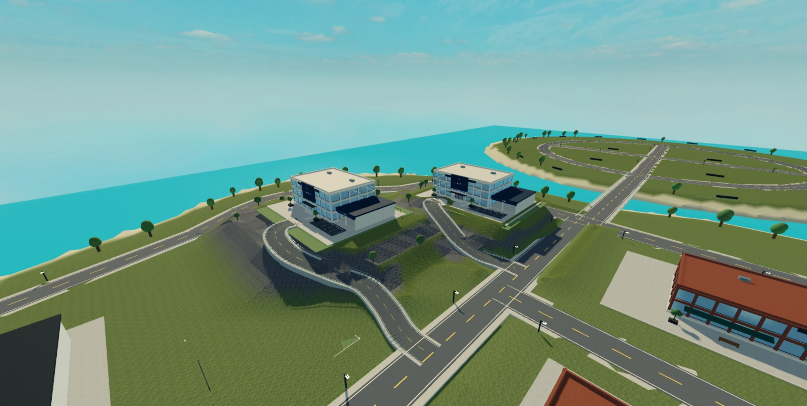

# RTA 기획 포트폴리오

RTA는 ALPHA Studio에서 공동 제작 중인 Roblox 도시 생활·역할수행 게임입니다. 제작 기간은 3개월, 팀 규모는 18명입니다. 이 저장소는 기획 참여와 공동 프로젝트 자료를 구분하여 정리한 참고 자료입니다.

## 담당과 코드 출처

지원자의 담당은 기획과 UI입니다

## 구성

- `source/`: 업로드한 RTA.rbxl에서 추출한 Luau 소스 621개와 index.json.
- `build/RTA.rbxl`: 장소파일입니다
- `BUILD.md`: Roblox Studio에서 설치하는 방법입니다.

## 현재 상태

